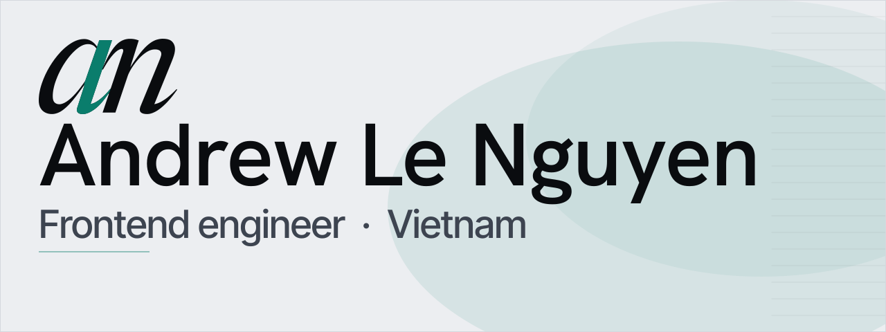
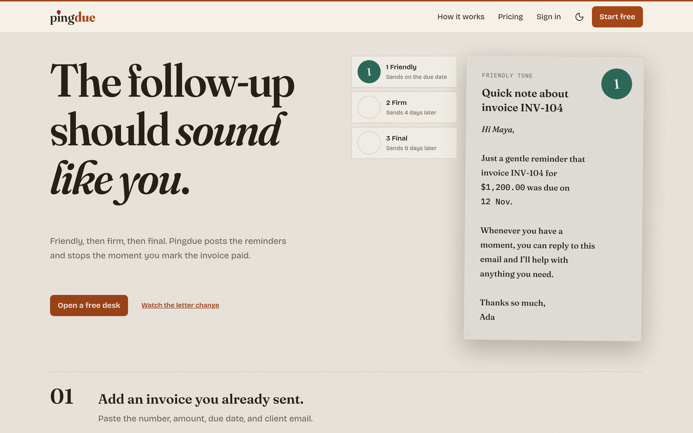
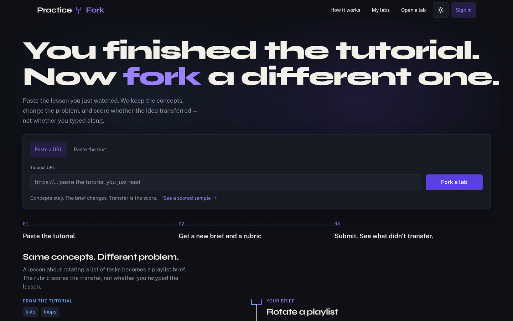
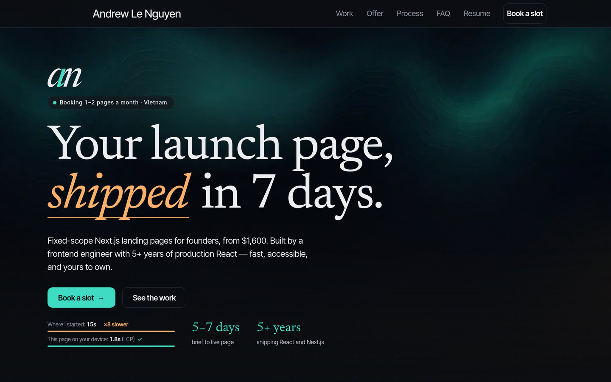

  <picture>
    <source media="(prefers-color-scheme: dark)" srcset="assets/header-v2-dark.svg">
    <source media="(prefers-color-scheme: light)" srcset="assets/header-v2-light.svg">
    
  </picture>

I'm a frontend engineer in Vietnam (UTC+7). I build production interfaces in React and Next.js — the architecture, the rendering performance, and the parts people actually touch.

I'm a senior front-end engineer at G.B.G Group Services. Before that I was at TIKI Corporation. I also take a small number of [fixed-scope Next.js landing pages](https://andrewlenguyen-site.vercel.app) for founders.

## Now building

**[Pingdue](https://pingdue.vercel.app)** — Invoice reminders that sound like you. Friendly, then firm, then final, and they stop the moment the invoice is marked paid.

Next.js · TypeScript · Tailwind CSS · Auth.js · [Live](https://pingdue.vercel.app)

**[Practice Fork](https://practice-fork.vercel.app)** — Paste a tutorial. The concepts stay, the problem changes, and the score is whether the idea transferred — not whether you typed along.

Next.js · TypeScript · Tailwind CSS · AI SDK · [Live](https://practice-fork.vercel.app)

**[Personal site](https://andrewlenguyen-site.vercel.app)** — Fixed-scope Next.js landing pages for founders.

Next.js · TypeScript · Tailwind CSS · [Live](https://andrewlenguyen-site.vercel.app)

## Featured work

**01  Event booking map** — Sections, seats, and live seat status, drawn in Konva.
[Repository](https://github.com/DrewIndeed/vite-konva-booking-map-2023)

**02  Tripcy Closet** — A fashion-studio site. The 2023 build measured 100/100 on Lighthouse.
[Repository](https://github.com/DrewIndeed/vite-tripcy-closet-2023) · [Live](https://vite-tripcy-closet-2023.vercel.app)

**03  AI SaaS tool** — An AI SaaS tool built with Next.js 13 and shadcn/ui.
[Repository](https://github.com/DrewIndeed/nextjs13-ai-saas-2023)

**04  GIPHY explorer** — A GIPHY explorer built with Vite and TypeScript.
[Repository](https://github.com/DrewIndeed/vite-giphy-2023) · [Live](https://vite-giphy-2023.vercel.app)

Also public: [MavenBond/mavenbond-frontend](https://github.com/MavenBond/mavenbond-frontend) and [rmit-enterprise-development/scrumified-frontend](https://github.com/rmit-enterprise-development/scrumified-frontend).

## Stack

TypeScript · React · Next.js · Tailwind CSS · TanStack Query · SWR · GraphQL · Vite · Vercel

## Contact

  <a href="mailto:anle.drewindeed@gmail.com" title="Email Andrew Le Nguyen">
    <picture>
      <source media="(prefers-color-scheme: dark)" srcset="assets/icon-mail-dark.svg">
      <source media="(prefers-color-scheme: light)" srcset="assets/icon-mail-light.svg">
      
    </picture>
  </a>
  <a href="https://www.linkedin.com/in/truonganln" title="Andrew Le Nguyen on LinkedIn">
    <picture>
      <source media="(prefers-color-scheme: dark)" srcset="assets/icon-linkedin-dark.svg">
      <source media="(prefers-color-scheme: light)" srcset="assets/icon-linkedin-light.svg">
      
    </picture>
  </a>
  <a href="https://andrewlenguyen-site.vercel.app" title="Andrew Le Nguyen’s site">
    <picture>
      <source media="(prefers-color-scheme: dark)" srcset="assets/icon-site-dark.svg">
      <source media="(prefers-color-scheme: light)" srcset="assets/icon-site-light.svg">
      
    </picture>
  </a>

