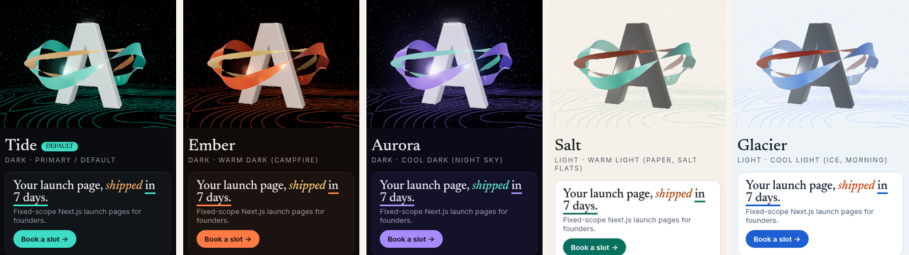

<a href="https://andrewlenguyen-site.vercel.app">
  <picture>
    <source media="(prefers-color-scheme: dark)" srcset="assets/banner-dark.png">
    <source media="(prefers-color-scheme: light)" srcset="assets/banner-light.png">
    
  </picture>
</a>

### Seven days. Then I go hiking.

I trek mountains for fun and ship production React for a living: 5+ years, five product teams, now senior front-end engineer at G.B.G in Vietnam (UTC+7). On the side I take a few fixed-scope launch pages for founders: one scope, one price, one revision, live in 5–7 days.

**D1** Intake &nbsp;→&nbsp; **D2** Wireframe &nbsp;→&nbsp; **D3–5** Build &nbsp;→&nbsp; **D6** Revision &nbsp;→&nbsp; **D7** Live

 

#### Now building

**[Pingdue](https://pingdue.vercel.app)**: Invoice reminders that sound like you. Friendly, then firm, then final, and they stop the moment the invoice is marked paid. 
Next.js · TypeScript · Tailwind CSS · Auth.js

**[Practice Fork](https://practice-fork.vercel.app)**: Paste a tutorial. The concepts stay, the problem changes, and the score is whether the idea transferred, not whether you typed along. 
Next.js · TypeScript · Tailwind CSS · AI SDK

 

#### Selected work

**01 &nbsp; [This site](https://andrewlenguyen-site.vercel.app/work/this-site)** 
Case study · Next.js 
The portfolio is the sample: the fixed-scope offer, the build receipt and the 7-day process, all in one page.

**02 &nbsp; [LG × VALORANT Booking](https://andrewlenguyen-site.vercel.app/resume#projects)** 
Freelance · 2024 · Vite, TypeScript, Node.js 
Seat booking for LG × VALORANT gaming rooms. I led the front-end team on the player booking page and the whole admin dashboard, which also works as the CMS.

**03 &nbsp; [Tripcy Closet](https://andrewlenguyen-site.vercel.app/resume#projects)** 
Freelance · 2023 · Landing page 
A landing page for a Vietnamese clothing brand, with careful image processing and motion. It scored 100/100 on Lighthouse.

**04 &nbsp; [Relay](https://andrewlenguyen-site.vercel.app/work/relay)** 
Self-initiated concept · Next.js 
A landing page for an AI support agent: the brief, the constraints and every decision, written up as a case study.

**05 &nbsp; [Event booking map](https://github.com/DrewIndeed/vite-konva-booking-map-2023)** 
Open source · Konva 
Sections, seats, and live seat status, drawn in Konva.

 

#### Five themes, one site

<a href="https://andrewlenguyen-site.vercel.app">
  <picture>
    <source media="(prefers-color-scheme: dark)" srcset="assets/themes-dark.png">
    <source media="(prefers-color-scheme: light)" srcset="assets/themes-light.png">
    
  </picture>
</a>

Tide is home. Hit the shuffle button on the site for Ember, Aurora, Salt or Glacier: the whole page and the 3D scene change together.

 

#### Stack

TypeScript, React, Next.js (App Router), TanStack Query, TanStack Virtual, GraphQL, Tailwind CSS, Vite and Vercel.

 

#### Start a project

[**Send your page goal →**](https://andrewlenguyen-site.vercel.app/#contact) &nbsp;·&nbsp; [anle.drewindeed@gmail.com](mailto:anle.drewindeed@gmail.com) &nbsp;·&nbsp; [LinkedIn](https://www.linkedin.com/in/truonganln) &nbsp;·&nbsp; [Resume](https://andrewlenguyen-site.vercel.app/resume)
