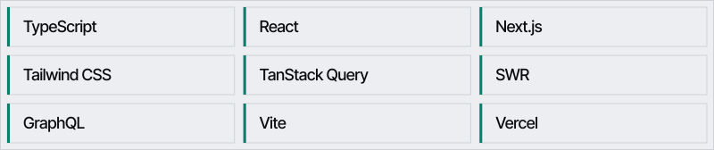

  <picture>
    <source media="(prefers-color-scheme: dark)" srcset="assets/header-dark.svg">
    <source media="(prefers-color-scheme: light)" srcset="assets/header-light.svg">
    
  </picture>

I'm a frontend engineer in Vietnam (UTC+7). I build production interfaces in React and Next.js — the architecture, the rendering performance, and the parts people actually touch.

I'm a senior front-end engineer at G.B.G Group Services, working on [Gigsberg](https://www.gigsberg.com/), a ticket marketplace. Before that I was at TIKI Corporation. I also take a small number of [fixed-scope Next.js landing pages](https://andrewlenguyen-site.vercel.app) for founders.

## Now building

- **[Pingdue](https://pingdue.vercel.app)** — Invoice reminders that sound like you. Friendly, then firm, then final, and they stop the moment the invoice is marked paid.
- **[Practice Fork](https://practice-fork.vercel.app)** — Paste a tutorial. The concepts stay, the problem changes, and the score is whether the idea transferred — not whether you typed along.

## Featured work

Public repositories, including the ones pinned on this profile.

| Project | What it is |
| --- | --- |
| **[vite-konva-booking-map-2023](https://github.com/DrewIndeed/vite-konva-booking-map-2023)** | A React module for event booking maps: sections, seats, and live seat status, built with Konva. |
| **[vite-tripcy-closet-2023](https://github.com/DrewIndeed/vite-tripcy-closet-2023)** · [Live](https://vite-tripcy-closet-2023.vercel.app) | A fashion-studio site built with Vite. The 2023 build measured 100/100 on Lighthouse. |
| **[nextjs13-ai-saas-2023](https://github.com/DrewIndeed/nextjs13-ai-saas-2023)** | An AI SaaS tool built with Next.js 13 and shadcn/ui. |
| **[vite-giphy-2023](https://github.com/DrewIndeed/vite-giphy-2023)** · [Live](https://vite-giphy-2023.vercel.app) | A GIPHY explorer built with Vite and TypeScript. |

Also pinned: [MavenBond/mavenbond-frontend](https://github.com/MavenBond/mavenbond-frontend) and [rmit-enterprise-development/scrumified-frontend](https://github.com/rmit-enterprise-development/scrumified-frontend).

## Stack

  <picture>
    <source media="(prefers-color-scheme: dark)" srcset="assets/stack-dark.svg">
    <source media="(prefers-color-scheme: light)" srcset="assets/stack-light.svg">
    
  </picture>

## Contact

[anle.drewindeed@gmail.com](mailto:anle.drewindeed@gmail.com) · [LinkedIn](https://www.linkedin.com/in/truonganln) · [Site](https://andrewlenguyen-site.vercel.app)
